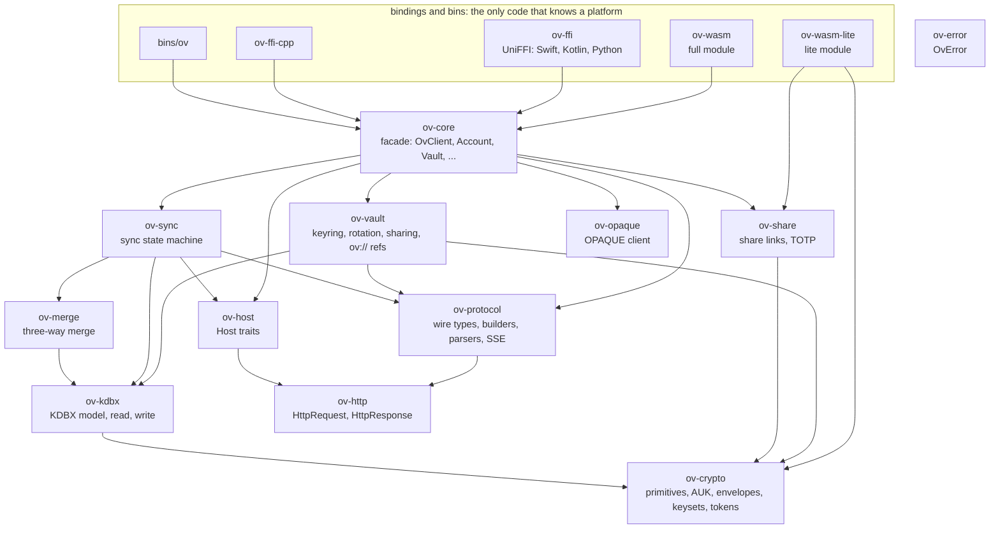

# Architecture

openvireo-core is the client side of the OpenVireo protocol, written once in Rust: account crypto,
OPAQUE sign-in, sessions and tokens, the vault keyring and sharing, share links, sync, KDBX and the
three-way merge. Every client calls it:

| Client | Repo | Binding | How the client gets it |
|---|---|---|---|
| `@openvireo/sdk` 1.0, and through it the web app | openvireo-sdk, openvireo-web | `bindings/ov-wasm` + `bindings/ov-wasm-lite` (wasm-bindgen) | the `@openvireo/core-wasm` npm package (vendored as a tarball until it is published) |
| iOS app and its AutoFill extension | openvireo-ios | `bindings/ov-ffi` (UniFFI) | `scripts/build-vendor.sh` runs `cargo xtask xcframework` at a pinned commit and links the static libraries |
| Desktop (Qt) | openvireo | `bindings/ov-ffi-cpp` (cxx) | Corrosion builds a wrapper crate that pins `ov-ffi-cpp` to a git commit |
| `ov` CLI | this repo | none (native Rust) | `bins/ov` |
| Python programs | any | `bindings/ov-ffi` (UniFFI) + `bindings/python` | wheels on the GitHub release ([guide](bindings/python.md)) |
| JVM and Android programs | any | `bindings/ov-ffi` (UniFFI) + `bindings/kotlin` | GitHub Packages Maven ([guide](bindings/kotlin-java.md)) |

All three apps pin the same commit today: `966606d` (tag `contract-v1.8`).

The servers (auth in Python, sync in C++) don't use the core. They share only the contract and its
test vectors with it.

## What stays in each platform

The core does no I/O. It never opens a socket or a file, reads the clock or touches a keychain.
Each platform passes in a **Host** (below), so TLS, proxies, certificate pinning and the system keychain
stay with the platform. UI, platform storage, AutoFill, auto-type and browser integration stay native.
The desktop still uses KeePassXC's own `format/` code for **local** `.kdbx` files and for the
`Database` it shows. The core runs the sync merge of its account vaults on serialized bytes.

## Layers

Every crate also depends on `ov-error` (not drawn). Dependencies only point downward. The bindings
also reach below the facade for the low-level calls their clients need (see each binding's README).

## Crate map

Lines are non-test Rust in `src/` on 2026-11-21.

| Crate | Lines | What it is |
|---|---|---|
| `crates/ov-error` | 358 | `OvError { code, message, status, retry_after, details, server_code }` and `OvErrorCode`. The codes are the TS SDK's `OpenVireoErrorCode` one for one, plus the codes it threw without listing, plus `internal`. `wire_code()` is the stable string (`"plan_limit"`) every binding exposes. Frozen. |
| `crates/ov-http` | 104 | `Method`, `HttpRequest`, `HttpResponse`. In their own crate so `ov-protocol` can use them without depending on `ov-core`. Frozen. |
| `crates/ov-host` | 232 | The Host traits and `Host` struct, re-exported as `ov_core::host`. Frozen. |
| `crates/ov-crypto` | 2,014 | SPEC §1–§7, §9, §18: HKDF, XChaCha20-Poly1305, Argon2 (`primitives`, frozen), X25519 with low-order rejection and Ed25519 (`curves`), Secret Key, AUK, envelopes (wrap, seal), keysets and public keys, vault names, service-account and refresh tokens, JWT, restore proofs. |
| `crates/ov-opaque` | 703 | OPAQUE (RFC 9807, SPEC §8) over opaque-ke 4.0.1, compatible with the libopaque auth server and with accounts the old libopaque desktop client registered. Optional `test-server` feature (the server half, for tests). |
| `crates/ov-protocol` | 3,709 | Wire types for `openapi.yaml` and `sync-openapi.yaml`, a pure `build_*` / `parse_*` pair per route, the HTTP status → `OvError` mapping, the SSE parser and discovery. No async, no Host. |
| `crates/ov-kdbx` | 3,894 | Its own KDBX crate ([ADR 0002](adr/0002-kdbx.md)): the frozen document model (`model.rs`), a reader for KDBX 3.1, 4.0 and 4.1 and a writer for 4.0 and 4.1. Unknown XML elements survive a round trip. |
| `crates/ov-merge` | 2,321 | The three-way sync merge on the ov-kdbx model, with the same rules as the desktop's `SyncEngine` and the SDK's `docs/merge-behaviour.md`, checked against `vectors/merge-fixtures/`. Also KDBX import (merge or copies). |
| `crates/ov-share` | 1,385 | Share links (SPEC §22): padding, passcode and content keys, payload and reference encryption, link format and parsing, TOTP. No I/O. |
| `crates/ov-vault` | 1,787 | Keyring and vault keys, key rotation, member sealing and confirmation, service-account master keys, `ov://` references. Pure: inputs are wire types, outputs are request bodies. |
| `crates/ov-sync` | 1,841 | The sync state machine (SPEC §11, §20): download, merge, conditional upload with retries, deletions, rollback and lost-database detection, offline cache, clock-skew check. |
| `crates/ov-core` | 10,047 | The facade (`api/`, frozen signatures) and its implementation (`impls/`, `state.rs`). It only orchestrates; the logic is in the crates above. |
| `crates/ov-testkit` | 5,915 | Dev-only: typed loaders for `vectors/`, fixed and manual clocks, in-memory auth and sync servers (`TestServers`) with real EdDSA JWTs and fault injection. Native only. |
| `bindings/ov-wasm` | 5,111 | The full wasm module and the npm package template (`npm/`: loaders, Host adapters, `.d.ts`). [README](../bindings/ov-wasm/README.md) |
| `bindings/ov-wasm-lite` | 30 | The lite wasm module: primitives, share links and TOTP. No code of its own; it compiles `ov-wasm`'s shared modules again. |
| `bindings/ov-ffi` | 5,090 | UniFFI binding: Swift module `OpenVireoRustCore`, C module `OpenVireoRustCoreFFI`; `uniffi.toml` also configures Kotlin (`com.openvireo.core`) and Python. [README](../bindings/ov-ffi/README.md) |
| `bindings/ov-ffi-cpp` | 7,360 | cxx binding: `libovcore` + `<ovcore.h>` (namespace `ov`), C++17. [README](../bindings/ov-ffi-cpp/README.md) |
| `bins/ov` | 4,531 | The `ov` CLI, on the facade, with a reqwest Host. |
| `xtask` | | Build and check tasks (`cargo xtask help`). |

## The Host

`crates/ov-host/src/lib.rs`. Each platform implements five traits and passes them in a `Host` to
`OvClient::new(config, host)`:

| Trait | What the core asks for | SDK (`packages/sdk/src/core/host.ts`) | iOS (`OpenVireoCore/Host/`) | Desktop (`src/account/CoreHost.*`) | `ov` (`bins/ov/src/host.rs`) |
|---|---|---|---|---|---|
| `HttpTransport` | `send` a request; `open_stream` for SSE (returns a `ByteStream`). Must not follow redirects | `fetchTransport` over the app's `fetch` | `URLSessionTransport` | `QNetworkAccessManager`, so Qt's proxy settings apply | reqwest with rustls and the OS trust store |
| `SecureStore` | `get` / `set` / `delete` bytes by key | the app's `KeyValueStorage` (`storageStore`) | Keychain (`CoreSecureStore`) | `SyncTokenStore` (memory in test binaries) | `session.json`, mode 0600 |
| `BlobCache` | the offline cache (SPEC §20), keyed by user and vault, plus per-user metadata | the app's `KeyValueStorage` when offline is on (`storageCache`), else `memoryCache` | `FileBlobCache` | files under `<accounts root>/<user>/core/` | files under `<config dir>/cache/` |
| `Clock` | `now_unix_ms` | `systemClock` | `SystemClock` (`SystemServices.swift`) | `core/Clock` (so tests can use `MockClock`) | system clock |
| `LogSink` | `log(level, target, msg)` | the app's `log` option, else none | `OSLogSink`: os_log, subsystem `com.openvireo.core` | `qDebug`, category `openvireo.core` | stderr, when `OPENVIREO_LOG` is set |

Rules that hold for every Host:

- The async traits use `async_trait`; on wasm32 they are `?Send` (one thread, JS values).
- `SecureStore` keys are the names the TS SDK and iOS already used, so stored sessions and Secret Keys
  carried over when the clients moved to the core.
- `TransportError::Cancelled` becomes `aborted`; the other transport errors become `network_error`.
- `HttpRequest`'s `Debug` never prints header values (bearer tokens).
- Randomness is not part of the Host. The core uses `getrandom` (the OS CSPRNG, and
  `crypto.getRandomValues` on wasm).

## The facade

`crates/ov-core/src/api/`. Start at `OvClient`.

| Handle | Made by | What it does |
|---|---|---|
| `OvClient` | `OvClient::new(config, host)` | discovery, `connect(issuer)` → `Account`, remembered accounts, local files (`open_local`, `create_local`), `share_info` / `open_share` |
| `Account` | `OvClient::connect` | register, sign in (`login` → `LoginStep::NeedsTotp` or `Unlocked`), offline unlock, lock, sign out; vaults (list, open, create, rename, delete, import, `sync_vault_kdbx` for clients that hold the vault as a file); sharing, orgs, members, key rotation; share links; settings, devices, two-step, plan; recovery, restore, deletion; `subscribe` (events); `access_token` |
| `Vault` | `Account::open_vault`, `OvClient::open_local` | entries, groups, fields, attachments, history, Recycle Bin, `sync`, export, import from another `Vault` |
| `ServiceAccount` | from an `ov_sa_` token | granted vaults, read and write references, `sync_vault_kdbx` |
| `SelfHosted` | pairing or a device token | standalone sync server: sync a database's bytes, history, download, health |
| `EventStream`, `TotpChallenge` | `Account::subscribe`, `login` | live events (SSE parsed in the core); the second sign-in step |

The rules every binding follows (from `api/mod.rs`):

- Types that cross the boundary are plain records and enums. Handles are cheap `Clone` objects with an
  `Arc` inside, safe to share between threads.
- Secrets cross as `Vec<u8>` (`SecretBytes`, UTF-8 for text). The core wipes what it is given; the caller
  wipes what it receives.
- Every fallible call returns `Result<T, OvError>`. A panic is caught at the binding edge and becomes
  `internal`.
- Calls that may touch the network or run a KDF are `async` and take a `CancelToken`. A cancelled call
  returns `aborted`. Each binding maps `async` its own way: Promises on wasm, Swift `async` on iOS,
  **blocking** calls on C++ (the desktop calls the core from a worker thread, never the GUI thread),
  asyncio coroutines in Python, `suspend` functions in Kotlin and `CompletableFuture`s in Java.

[`api-coverage.md`](api-coverage.md) maps every public method of the TS SDK's `Account`, `AccountVault`,
`ServiceAccount`, `SelfHostedSync` and the iOS `Account` to the facade method that replaced it.
`cargo doc --workspace --no-deps --open` gives the rustdoc, which cites the SPEC section for each call.

## Errors

One type, `OvError`. Bindings expose the wire string as the error's code, so UI code that matched on
the TS SDK's `err.code` keeps working:

- wasm: `OvError` class (`code`, `status`, `retryAfter`, `details`, `serverCode`); the SDK turns it into
  `OpenVireoError` with the same code.
- Swift: a one-variant UniFFI error with field accessors.
- Python: `OvError` (`code`, `wire_code`, ...); Kotlin: `OvException` with extension properties, and
  `JErrors` for Java futures.
- C++: `rust::Error` with `"<code>: <message>"`; `ov::call(...)` gives an `ov::Error` with every field.

`details` is a JSON object string with camelCase keys. Since `contract-v1.7`, sign-in `unauthorized`
errors carry `details.reason` = `"opaque_refused"` (wrong email or password) or
`"keyset_unwrap_failed"` (wrong Secret Key).

## Secrets in memory

- Key material is wiped with `zeroize`; secrets in records are `Zeroizing` / `secrecy` types, and
  `Debug` implementations don't print them.
- The release profile has no `panic = "abort"`: the bindings catch panics at the FFI edge.
- wasm-bindgen copies arguments into linear memory and frees them unzeroed, so the wasm module's global
  allocator zeroes every block on free and the loaders scrub the dead stack after each call
  (`bindings/ov-wasm/README.md`, "Wiping linear memory").
- Argon2's work area (up to 64 MiB) is wiped after each hash on every target.

## Build-time settings that matter

- `rust-toolchain.toml` pins Rust 1.98.1 and installs the wasm32 and iOS targets.
- `.cargo/config.toml` sets `--cfg aes_armv8` on aarch64. Without it, AES (and AES-KDF, often millions of
  rounds) runs in software, about 30 times slower. A build started from another directory (Corrosion in
  the desktop) doesn't read that file and must pass the cfg itself; the desktop's
  `cmake/OpenVireoCore.cmake` does.
- The release profile is `opt-level = "z"`, LTO, one codegen unit, stripped. Dev builds optimise
  argon2, blake2 and aes, because tests run the KDFs many times.

## Further reading

- [contract.md](contract.md): what is frozen and how it changes
- [building.md](building.md): building each binding and the CLI
- [bindings/](bindings/README.md): the language bindings compared, and the Python and Kotlin/Java guides
- [testing.md](testing.md): `cargo xtask ci`, vectors, the corpus, binding tests, cross-client e2e
- [open-items.md](open-items.md): known bugs and follow-ups
- [ADR 0001](adr/0001-contract.md) (the contract), [ADR 0002](adr/0002-kdbx.md) (own KDBX crate)
- The plan: `openvireo-dev-guide/plans/rust-core.md` and `rust-core-tasks.md` (private)
